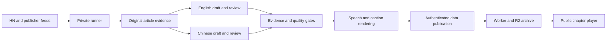

# Architecture and boundaries

The public site has no OpenAI credential or model-generation endpoint. Its write token is independent of both the OpenAI key and Cloudflare deployment credentials.

## Quality and budget

Selection checks the target date and exact evidence excerpt. Draft checks preserve story order, original-language evidence excerpts and length. A fresh-context review must pass all five scores and have no critical errors. Chinese writing and review receive original sources, never the English draft.

Speech is produced in bounded chunks. Transcript comparisons detect some omissions/additions; only known mismatches are retried, up to three attempts. Transport failures retain reserved cost rather than blindly retrying. Audio sample counts establish caption and chapter timing; final duration and byte-range playback are checked before completion. Videos reuse the narration and locally rendered caption cards; FFmpeg encoding adds no API calls. Encoding, storage and bandwidth are separate hosting/runner costs.

Verified speech chunks are atomically checkpointed as private WAV files and transcript/hash metadata. Explicit recovery validates the script, voice, audio format, transcript and hash before reuse. Complete recordings also undergo chapter, duration and video-decoding checks. Recovery never imports a prior cost ledger or resets cumulative spending. Saved artifacts survive ordinary failed jobs; hard runner loss or cancellation may prevent artifact upload.

The $5.00 daily API ledger is a conservative estimate based on explicit prices and known usage. Uncertain requests remain reserved. A resumed failed job carries prior spending, and the shared daily claim prevents concurrent runs. A crashed/aborted job remains blocked rather than automatically regenerating. Do not manually reset its state without reconciling provider charges. The local ledger cannot constrain outside use of a key or hosting traffic.

A source/model outage, failed evidence check, excessive length, failed quality gate or insufficient budget prevents publication; the previous edition remains readable. This is intentional. Scores are not a guarantee of truth, translation accuracy, rights clearance or natural pronunciation.

## Open-source separation

This repository starts with a new history, contains only code and fictional examples, and runs no daily generation. Private operations retain source texts and working drafts needed for review/recovery. Only approved summary metadata and media are published to the site. No automatic synchronization from public `main` to a secret-bearing job is configured.

## Source fetching

Only public HTTPS URLs with bounded bodies and a bounded number of redirects are accepted. Public DNS checks are not complete network isolation. Use an isolated hosted runner without internal services, ambient cloud instance credentials or a sensitive local network. Article and comment contents may contain hostile instructions; never turn those contents into commands or URLs carrying credentials.
